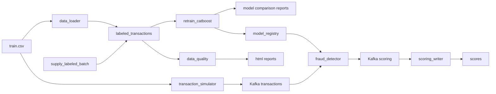

# Антифрод: поток транзакций, скоринг и переобучение

Учебный проект обнаружения мошеннических транзакций. Kafka несёт непрерывный поток событий, CatBoost скорит их текущей моделью, а Airflow по расписанию дописывает размеченные месяцы и переобучает модель.

Датасет можно найти [здесь](https://www.kaggle.com/competitions/teta-ml-1-2025/data). В этом занятии используется файл `train.csv` из каталога практики занятия 07. Путь задаётся переменной `TRAIN_DATA_CSV`.

---

## Архитектура



| Сервис | Описание |
|--------|----------|
| **Kafka** | Шина сообщений между симулятором потока, скорингом и записью результатов |
| **Zookeeper** | Координация Kafka в используемой конфигурации |
| **Kafka UI** | Просмотр топиков `transactions` и `scoring` |
| **transaction_simulator** | Бесконечно шлёт в `transactions` случайные строки CSV. У каждой новый `transaction_id` и `transaction_time`, равный текущему моменту, формат `YYYY-MM-DD HH:MM` |
| **fraud_detector** | Препроцессинг и инференс CatBoost. Перед скорингом читает `/models/latest.txt` и подхватывает `my_catboost_<версия>.cbm` без перезапуска |
| **scoring_writer** | Читает топик `scoring` и пишет `score`, `fraud_flag` и `model_version` в PostgreSQL |
| **PostgreSQL** | Витрина `labeled_transactions`, состояние окна `training_state` и таблица `scores` |
| **data_loader** | При старте один раз загружает весь CSV в витрину и собирает исходное окно обучения: январь–март 2019 |
| **airflow** | Три DAG каждые 5 минут: поставка нового размеченного месяца, переобучение CatBoost и проверка качества данных |

Общий том `model_registry` смонтирован в Airflow как `/opt/airflow/models` и в `fraud_detector` как `/models`. Логика задач вынесена в `pipeline/`. Файлы в `dags/` только связывают задачи.

Каталог `reports` смонтирован в Airflow как `/opt/airflow/reports`

---

## Структура проекта

```
.
├── fraud_detector/           # Онлайн-скоринг
├── transaction_simulator/    # Непрерывная поставка транзакций в Kafka
├── scoring_writer/           # Запись скоров в PostgreSQL
├── data_loader/              # Первичная загрузка размеченной витрины
├── dags/
│   ├── retrain_catboost.py   # DAG переобучения
│   └── supply_labeled_batch.py
│   └── data_quality.py       # DAG проверки качества данных
├── pipeline/
│   ├── db.py                 # Подключение к витрине и training_state
│   ├── data_quality.py       # DQ-проверки и HTML-отчёт
│   ├── retrain/              # Функции задач переобучения
│   └── supply/               # Функции задач поставки месяца
├── reports/
│   ├── comparison/           # json-отчёты сравнения моделей
│   └── quality/              # HTML-отчёты DQ
├── airflow/                  # Образ Airflow с CatBoost
├── docker-compose.yaml
├── .env.example
└── README.md
```

---

## Что происходит после запуска

1. `data_loader` копирует `TRAIN_DATA_CSV` в `labeled_transactions` и сохраняет окно января–марта 2019. Повторный старт с сохранёнными томами витрину не перезаливает.
2. `transaction_simulator` каждые 0.1 секунды отправляет в Kafka случайную транзакцию с текущим временем.
3. `fraud_detector` скорит поток моделью из общего каталога. До первого переобучения версия — `initial`: в каталог копируется модель из образа.
4. `scoring_writer` складывает результат в `scores`, включая `model_version`.
5. DAG `supply_labeled_batch` каждые 5 минут берёт из витрины до 100 тысяч случайных строк, переносит их время в следующий календарный месяц и дописывает батч. Наблюдения старше трёх лет относительно самого нового месяца удаляются.
6. DAG `retrain_catboost` каждые 5 минут забирает следующий месяц витрины, начиная с апреля 2019, готовит новое трехмесячное окно и обучает CatBoost. Перед публикацией кандидат сравнивается с действующей моделью.
7. Если кандидат проходит проверку, публикуется `my_catboost_<timestamp>.cbm`, обновляются окно и указатель месяца. Сервис скоринга подхватывает новую версию без перезапуска.
8. DAG `data_quality` каждые 5 минут проверяет размеченную витрину и сохраняет HTML-отчёт.

Переобучение и поставка идут по разным указателям месяца. `retrain_catboost` читает исторические месяцы с апреля 2019. `supply_labeled_batch` каждый раз создаёт месяц после максимальной даты витрины, первый такой месяц — апрель 2020. Окно обучения ещё долго не доходит до этих батчей, и очистка трёх лет его не затрагивает.

Все три DAG можно запустить вручную в Airflow, не дожидаясь расписания. У всех выключен `catchup`. Если очередного месяца в витрине ещё нет, задачи переобучения пропускаются.

---

## Препроцессинг

Препроцессинг находится в `fraud_detector/src/preprocessing.py`.

Помимо расстояния между клиентом и продавцом и базовых календарных признаков добавлены:

| Признак | Описание |
|---------|----------|
| `week_day` | День недели |
| `is_night` | Ночная операция: 1 для времени с 00:00 до 05:59 |
| `log_amount` | Логарифм суммы транзакции |

День недели и ночное время позволяют учитывать временные особенности операций. Логарифм суммы уменьшает различия в масштабе небольших и крупных платежей.

---

### Проверка улучшения модели

Проверка реализована в `pipeline/retrain/check_model_quality.py`.

Кандидат и действующая модель оцениваются на одном и том же новом проверочном месяце. Для каждой модели признаки выбираются в ожидаемом ею порядке.

Используются:

- **ROC-AUC**
- **F1**

Кандидат публикуется только при выполнении обоих условий:

```text
candidate.roc_auc >= current.roc_auc
candidate.f1 >= current.f1
```

Если действующей модели нет, первый кандидат допускается при наличии обоих классов в проверочном наборе. Если класс только один, публикация пропускается.

JSON-отчёт сохраняется в:

```text
reports/comparison/comparison_<version>.json
```

В отчёте указаны версии моделей, проверочный месяц, число строк, метрики, решение `accepted` и причина решения.

При `accepted=False` вызывается `AirflowSkipException`. Задачи `check_model_quality` и `publish_model` получают состояние `skipped`. Действующая модель, текущее окно и указатель месяца остаются прежними.

Следующий запуск повторяет тот же месяц. При неизменных данных и параметрах кандидат может отклоняться повторно: автоматического перехода к следующему месяцу после отклонения нет.

### Сохранение модели

Одобренная модель публикуется в общий каталог:

```text
my_catboost_<version>.cbm
my_catboost_<version>.metrics.json
latest.txt
```

---


## Проверка качества данных

DAG `data_quality` запускается каждые 5 минут и проверяет всю таблицу `labeled_transactions`.

Функция находится в `pipeline/data_quality.py`.

| Правило | Условие |
|---------|---------|
| Обязательные колонки | Все поля из `LABELED_COLUMNS` присутствуют |
| Объём данных | Не менее 100 строк |
| Пропуски | Нет NULL в обязательных колонках |
| Целевая переменная | Только 0 и 1, оба класса присутствуют |
| Сумма транзакции | Положительная и конечная, без NULL и NaN |
| Время транзакции | Нет NULL и бесконечных дат |

Будущие даты разрешены, поскольку DAG поставки специально генерирует следующие месяцы.

HTML-отчёт сохраняется в:

```text
reports/quality/dq_<run_id>.html
```

В контейнере каталог находится рядом с моделями:

```text
/opt/airflow/models
/opt/airflow/reports/quality
```

Отчёт можно открыть браузером. Он содержит итог PASS/FAIL, результаты правил и число нарушений.

При нарушении правила HTML сначала сохраняется, затем задача завершается ошибкой.

DQ DAG работает независимо от переобучения.

---

## Технологии

- **Python 3.11**
- **ML**: CatBoost, pandas, numpy
- **Kafka**: потоковая обработка данных
- **PostgreSQL**: витрина размеченных данных и результаты скоринга
- **Airflow 2.10**: поставка месячных батчей и переобучение модели
- **Docker / Docker Compose**: оркестрация микросервисов

---

## Как запустить проект

### 1. Клонируйте репозиторий

```bash
git clone git@github.com:Poligonchik/MLOPS_hw3.git
cd MLOps_hw3
```

### 2. Создайте `.env` файл

```bash
cp .env.example .env
```

В `TRAIN_DATA_CSV` укажите путь к размеченному `train.csv` на вашей машине.

### 3. Запустите контейнеры

```bash
docker compose up --build
```

Нужны [Docker](https://docs.docker.com/engine/install/) и Docker Compose. Первый запуск скачивает образы и загружает витрину, это занимает несколько минут.

## Доступные сервисы

| Сервис | URL |
|--------|-----|
| **Kafka UI** | http://localhost:8080 |
| **Airflow** | http://localhost:8081 (`admin` / `admin`) |
| **PostgreSQL** | `localhost:5432`, база `fraud_db` |

Пользователь и пароль Postgres задаются в `.env` (`fraud_user` / `fraud_pass` в шаблоне).

Посмотреть витрины из контейнера:

```bash
docker compose exec postgres psql -U fraud_user -d fraud_db
```

---

## Таблицы PostgreSQL

Таблица `scores`:

| Поле | Тип | Описание |
|------|-----|----------|
| id | SERIAL | Уникальный ID |
| transaction_id | TEXT | Идентификатор транзакции |
| score | FLOAT | Вероятность мошенничества, порог 0.5 |
| fraud_flag | INT | 1, если score больше 0.5, иначе 0 |
| model_version | TEXT | Версия CatBoost, которая посчитала скор |
| created_at | TIMESTAMP | Время записи |

`labeled_transactions` — витрина размеченных транзакций. `training_state` хранит границы трёхмесячного окна обучения и месяц следующего батча.

Последние скоры:

```sql
SELECT transaction_id, score, fraud_flag, model_version, created_at
FROM scores
ORDER BY created_at DESC
LIMIT 20;
```

Модели, которые опубликовал DAG:

```bash
docker compose exec airflow ls -la /opt/airflow/models
```

---

## Как смотреть демонстрацию

1. В Kafka UI топик `transactions` пополняется каждые 0.1 секунды, топик `scoring` — ответами модели.
2. В Airflow откройте `supply_labeled_batch` и `retrain_catboost`. Кнопка Trigger запускает прогон сразу.
3. После публикации модели новые сообщения в `scores` получают свежий `model_version`.

### Очистка

`docker compose down -v` удаляет контейнеры вместе с витриной, окном обучения, реестром моделей и состоянием Airflow. Следующий запуск снова загрузит CSV.
